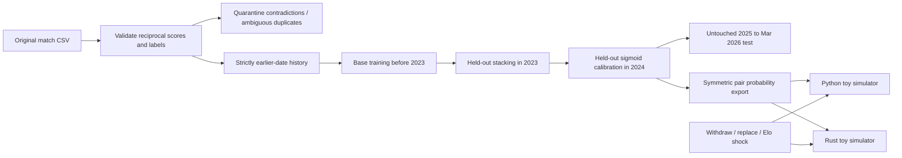

# Football Outcome Modeling and World Cup 2026 Toy Simulation

A research-methodology project by Fady Salib (original project period:
**June–July 2026**, owner-provided). It now separates **chronological historical
evaluation** from a **simplified tournament experiment**, with reproducible
Python/Rust simulation and team-event scenarios.

The original XGBoost/Random Forest/ExtraTrees/LightGBM/MLP four-layer notebook is
preserved in [the legacy archive](notebooks/legacy/FIFA_World_Cup_2026_leaky.ipynb).
It has known leakage and is not the default evaluation. The revised notebook
uses tested modules and a smaller, auditable held-out stack. No accuracy
improvement is assumed or claimed.

## Problem and architecture

The project asks whether historical match information supports useful outcome
probabilities, how stacking/calibration compare to simpler baselines, and how
event assumptions affect a tournament simulation. It is a retrospective software
experiment, not a validated World Cup forecast or betting recommendation.



## Actual implementation

- Reciprocal-record validation and evidence-based country-name cleanup; no
  silent guessing of contradictory match outcomes.
- Five pre-date features: reconstructed Elo difference, last-five form and goal
  balance differences, capped rest-day difference, and centered last-five H2H.
- Logistic regression, Elo-only, Random Forest and ExtraTrees comparisons;
  held-out logistic meta-model; held-out one-vs-rest sigmoid calibration with
  normalized probabilities. Model inference averages reversed perspectives to
  enforce complementary loss/win probabilities.
- Log loss, summed multiclass Brier score, accuracy, class-specific precision/
  recall/F1/support, confusion matrices, top-label calibration bins and ECE.
- Seeded SplitMix64/Poisson toy simulations in Python and dependency-free Rust;
  normalized matrix validation, event checks and exact stage-count comparison.

No current FIFA rankings, scraped Elo/xG, actual-match statistics or post-match
squad/age values enter the reviewed historical feature pipeline. The simulator's
static Elo/groups are separate, unverified scenario inputs.

## Setup

Tested with Python **3.12**, NumPy **2.2.6**, pandas **2.3.3**, SciPy **1.16.3**,
scikit-learn **1.6.1**, and Rust **1.85.1**. CPU-only; no hardware is required.

```bash
git clone https://github.com/fady-salib/fifa-wc2026-predictor.git
cd fifa-wc2026-predictor
python -m venv .venv
source .venv/bin/activate
pip install -r requirements.txt
python -m wc2026.evaluate --out outputs/review
jupyter lab FIFA_World_Cup_2026.ipynb
```

The CLI is the reproducible entry point; the notebook calls the same modules.
`requirements-legacy.txt` is optional archaeology support, not needed for the
reviewed pipeline. The original notebook is archived because of methodological
defects, not removed or represented as a valid independent evaluation.

## Data and evaluation protocol

The CSV is **committed**: 3,866 team-perspective rows. Historical Elo and xG
columns are entirely missing. Some mirror records assign the same non-draw
outcome/score to both opponents; some groups contain ambiguous duplicates.
Validation retains **1,859 unique matches** and quarantines **60 groups**.
[Data audit](docs/data-audit.json) records source line numbers/reasons; the raw
file is unchanged. Accepted records still need external verification.

| Purpose | Period in retained data | Matches / perspective rows |
|---|---|---:|
| Base fitting | 2018-01-11–2022-12-18 | 1,309 / 2,618 |
| Held-out stack fitting | 2023-01-25–2023-11-21 | 274 / 548 |
| Sigmoid calibration | 2024-01-13–2024-11-19 | 196 / 392 |
| Final test | 2025-01-18–2026-03-31 | 80 / 160 |

The stack sees predictions on a later block not used to fit its base models;
calibrators see a still later block, not training predictions. The test block
fits neither estimators nor calibrators. All matches on a date receive features
before any same-day result updates. Mirror rows stay in the same date/split.
During test evaluation, prior test-date results update history for subsequent
dates: this is **rolling one-step-ahead evaluation**, not a single frozen forecast
for the entire multi-year test. No observations on/after 2026-06-11 enter history.

## Results actually measured

The following came from an executed run on **2026-10-29**, seed 42. No parameters
were tuned against these test results. The small test contains **80 matches**;
its 160 mirrored rows are correlated, not 160 independent matches.

| Model | Test log loss ↓ | Brier sum ↓ | Accuracy |
|---|---:|---:|---:|
| Reconstructed Elo-only heuristic | 1.0302 | 0.6156 | 0.5375 |
| Logistic regression | 1.0570 | 0.6318 | 0.4875 |
| Random Forest | 1.1363 | 0.6851 | 0.5062 |
| ExtraTrees | 1.0622 | 0.6418 | 0.5000 |
| Held-out stack | 1.0692 | 0.6442 | 0.5000 |
| Sigmoid-calibrated stack | 1.0374 | 0.6252 | 0.5000 |

**Elo-only performed better than the calibrated stack on log loss and Brier here.**
These numbers are not evidence that the models generalize to World Cup 2026.
The full [evaluation artifact](docs/evaluation.json) includes class performance,
imbalance counts, confusion matrices and reliability bins. Brier is the mean
sum of squared errors over three classes (range 0–2), not divided by class count.
Raw data provenance, quarantining and sparse histories limit all conclusions.

## Simulation and event usage

```bash
python -m wc2026.simulation --sims 1000 --seed 42
cargo test --manifest-path rust/Cargo.toml --locked
cargo run --manifest-path rust/Cargo.toml --release -- --sims 2000 --event shock:France:-100
```

The default simulation uses the **unverified static Elo snapshot**, not the
trained stack. To use held-out ML probabilities at the declared 2026-06-11
scenario date:

```bash
python -m wc2026.export
cargo run --manifest-path rust/Cargo.toml -- --sims 200 --probs wc2026_prob_matrix.csv
python -m wc2026.simulation --sims 200 --probs wc2026_prob_matrix.csv
```

```python
from wc2026.simulation import Model, Scenario, TeamEvent
model = Model()
model.elo['Italy'] = 1900  # explicit hypothetical input, not a fetched rating
events = [TeamEvent('withdraw', 'Iraq', replacement='Italy'),
          TeamEvent('elo_shock', 'France', delta=-100)]
counts = Scenario(model, events).run(sims=1000, seed=42)
```

Withdrawal means 3–0 toy walkovers, or knockout elimination with
`knockout_only=True`. Replacement must be an unused team with explicit Elo and
occur before groups. At most **one unreplaced withdrawal** is supported; multiple
vacant slots need rules and are rejected. Ordered events referencing a removed
team fail; shocks on a replaced team are not transferred. Elo shocks tilt decisive
win/loss odds while holding draw probability fixed, even at extreme deltas.
They are hypothetical sensitivity inputs, not measured injury effects.

Same seed gives reproducible runs, not noise-free causal comparisons. Walkovers
change random-number consumption. Monte Carlo error and model/rule uncertainty
remain; a frequency is not an externally calibrated championship probability.

## Competition-rule limitations

The simulator retains 12 four-team groups, top two plus eight third-place teams,
and 32-team elimination. **Its bracket is not the official FIFA mapping:** it
pairs adjacent group winners/runners and third-place teams with each other.
Ranking uses points/GD/GF then random ties, omitting the official detailed
head-to-head, discipline and other tiebreak provisions. Third-place allocation
tables, match-number paths and authentic extra-time/penalty dynamics are absent.
It samples 72 group fixtures and 31 knockout fixtures, omitting the bronze match.
The legacy notebook's label of 96 group fixtures was incorrect.

Official regulation/bracket conformance was **not completed**: the FIFA format
page returned a client-rendered shell during this review, and no verified full
regulation/allocation table is bundled. Do not label this implementation official
or present its output as official-bracket tournament odds. A versioned, cited
regulation dataset and full bracket/tiebreak tests are required future work.

## Tests and reproducibility

```bash
python -m unittest discover -s tests -v
cargo fmt --manifest-path rust/Cargo.toml -- --check
cargo clippy --manifest-path rust/Cargo.toml -- -D warnings
cargo test --manifest-path rust/Cargo.toml --locked
cargo build --manifest-path rust/Cargo.toml --locked
python -m tools.compare_simulators
python -m tools.compare_simulators --probs wc2026_prob_matrix.csv
```

The baseline's 12 Rust tests passed. Reviewed checks passed: **15 Python tests,
18 Rust tests**, and exact unrounded Python/Rust stage-count parity for five
scenarios × 200 tournaments using Elo, then the same five using the exported ML
matrix. [Verification](docs/verification.md) distinguishes execution, evaluation
and limitations. The notebook modules ran; notebook UI/chart execution is not
claimed. GitHub workflow definitions are added, not assumed remotely passing.

## Repository, media, ownership and license

`wc2026/history.py`, `evaluate.py`, `export.py` and `simulation.py` contain reusable
logic; `tools/compare_simulators.py` checks ports; `rust/src/` preserves the native
simulator; `docs/` records audit/evidence; the legacy notebook remains archived.
See [file-by-file findings](docs/audit.md) and [CV/LinkedIn drafts](docs/portfolio.md).

No project images/video were supplied. Suggested media: a calibration comparison
plot drawn from `docs/evaluation.json`, an annotated toy-scenario comparison and
a CLI/notebook walkthrough. Label the rules, seed, sample count and software
revision; keep data-quality limitations visible. No fabricated dashboard or
performance claims are needed.

Original work belongs to Fady Salib; this 2026 review used AI-assisted audit,
methodology changes, tests and documentation. Confirm individual/team contributions
before claiming sole authorship. Code retains its [MIT license](LICENSE).
The committed match CSV has no verified upstream source/license record; the code
license does not establish data redistribution rights. Resolve that provenance
before claiming a reproducible public research dataset.
